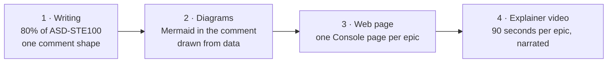

# Readable Output

The factory does more of the work each month. People now spend their time
reading what it wrote and deciding. So what it writes must be fast to read.

This sheet is the plan for that. It follows Andrej Karpathy's ladder for
reading LLM output: plain writing, then diagrams, then web pages, then
explainer videos. The rules themselves are in
[`FACTORY.md` §1a](https://github.com/genai-jerry/claude-software-factory/blob/v1/FACTORY.md#1a-writing-for-people).

## Where we start

329 agent comments scored across six repos (October 2026):

| | Words |
|---|---|
| Median | 37 |
| 90th percentile | 358 |
| Longest | 891 (Test Planner, beacon-api#34) |
| Comments that pass §1a | 99 of 329 (almost all one-line "run started" notices) |

The five causes:

1. No role prompt said how to write.
2. The comments use the factory's own words: gate codes, labels, config keys.
3. They explain how the factory works, and what the agent did not do.
4. The action for the reader is late, or missing.
5. They repeat what the linked files already hold.

## The ladder



Each step makes the one below it shorter. The comment stays short because the
page holds the detail. The page stays light because the video explains it.

### 1 · Writing (in progress)

- **Rules:** FACTORY.md §1a is injected into every role's prompt by both
  engines. An instruction has 20 words or fewer; a description has 25 or
  fewer. Other rules: the active voice, one word for one thing, gate names
  before gate codes, and no narrating.
- **One comment shape:**

  ```
  **<What happened, 15 words or fewer>**
  **You need to:** <one action>, or "Nothing. The factory continues."
  - up to 5 bullets
  Next: <who acts next>
  Links: <files and PRs>
  <details> Factory details </details>
  ```

- **Word budgets:**

  | Comment | Budget |
  |---|---|
  | Run started | 1 line |
  | Work ready for a person | 120 words |
  | Blocked or failed | 80 words |
  | Summary | 150 words |

- **Role prompts:** each one gets a before/after example. The Test Planner is
  done. Next are `release` and `dispatch`, then `reviewer`, `qa` and
  `implementer`, then the rest.

**The worst comment, rewritten** (891 words → 115):

> **Test plan ready for #34: 14 test cases.**
> **You need to:** nothing now. You approve the plan with the design at design approval (G2).
> - ST-1 to ST-9: status words from a real Google Sheet reach Beacon, and Beacon's writes land in the right columns.
> - ST-10: an opt-out word in the sheet stops the dialing.
> - ST-14 is the riskiest: Beacon's own write must not come back as a second outcome.
> - Testers need the epic branches of beacon-api, beacon-connectors and beacon-web running. Use the beacon-infra local stack.
> - Five cases make a real AI call to the tester's phone. Make one test call first.
>
> Next: the Architect writes the design on the same branch.
> Links: test-plan.md · test-data.md · #44–#57

### 2 · Diagrams

GitHub draws Mermaid in issues and comments. Three places:

| Where | Diagram |
|---|---|
| Dispatch, on the epic | Task dependency graph: ready now, and waiting on what |
| Test Planner, on the epic | Test case groups → the tasks they wait on |
| Every epic | A "you are here" strip from intake to staging |

The orchestrator draws them from `tasks.md` and the issue links, not the
model. So a diagram is always correct and costs nothing. A diagram with more
than 15 boxes goes on the web page instead.

### 3 · Web page per epic

The Console (sf.genaipeople.com) already loads each epic's documents for its
approval panel. One page per epic adds:

- the summary and the open questions
- the diagrams
- each task's state
- the test matrix

Every comment ends with a link to it. This is the factory's first rule —
"issues carry state plus a link" — applied to people too.

### 4 · Explainer video per epic

A narrated video of about 90 seconds, in the style of 3Blue1Brown:

| When | What it explains |
|---|---|
| Spec approval (G1) | The problem, and what will change for the user |
| Release to staging (GS) | What was built, shown on the diagrams, and what was tested |

How it will work:

- **Script and storyboard:** the model writes them from `proposal.md`,
  `design.md` and the test matrix, in the §1a style.
- **Animation:** an HTML page animates the step 2 diagrams. A headless
  browser records it to MP4. There is no separate animation toolchain.
- **Narration:** ElevenLabs, with the estate's own key, or a local
  text-to-speech model where no key is set.
- **Where it lives:** the epic's page in step 3. The GitHub API cannot attach
  a video to a comment, so the comment links to the page.
- **Opt-in per repo:** it costs minutes of compute and narration credit per
  epic, so a repo turns it on.

The video comes last because it needs steps 2 and 3. It animates their
diagrams and lives on their page.

## Measuring it

`scripts/comment-lint.js` scores a comment against §1a: words against the
budget, long sentences, a missing "You need to:" line, and internal terms.
Both engines can run it; it is plain Node.

- **Now: report only.** The orchestrator scores every run's comments and
  stores the scores on the run. Nothing is blocked.
- **Next: one rewrite.** A comment over budget sends the agent back once to
  shorten it, like the test-fix loop.
- **Target:** 90th percentile at 150 words or fewer, and no comment over 300.

## Related

- [`FACTORY.md` §1a](https://github.com/genai-jerry/claude-software-factory/blob/v1/FACTORY.md#1a-writing-for-people): the rules every role follows
- [[Control Architecture]]: where a comment comes from
- [[Repo Workspaces]]
