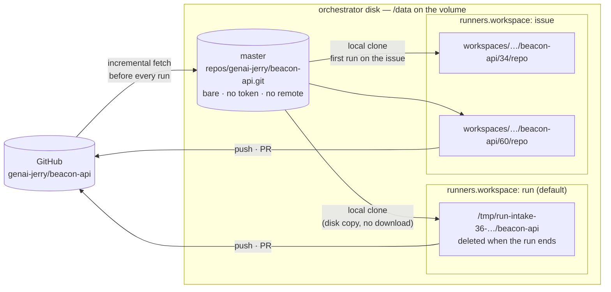
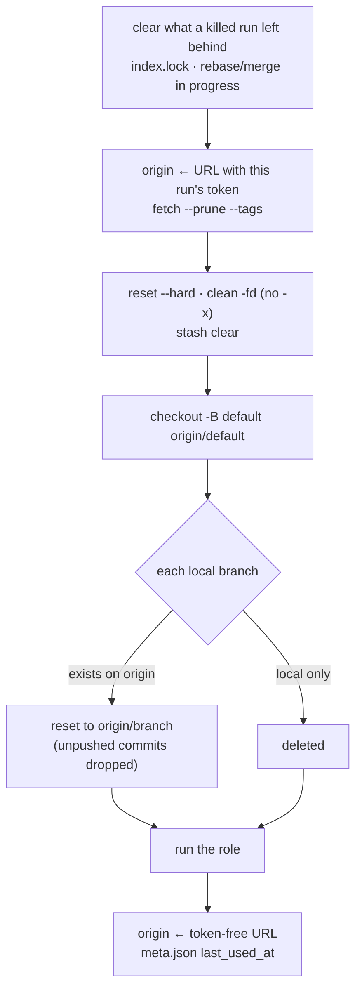
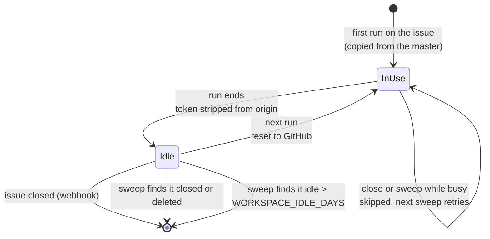

# Repo Workspaces

Under the LangGraph orchestrator every role run needs the consuming repo on
disk. This page covers where that checkout comes from, how long it lives and
what it is allowed to remember. Actions runs are unaffected: a GitHub runner
always starts from a fresh checkout.

The short version: **one master copy per repo, and one working copy per run
or per issue. The working copy is a cache, never state.**

## Two layers



- **Master.** One bare repository per consuming repo, built once and
  refreshed before every run with `fetch --prune` (branches and tags). It
  follows GitHub's default branch. Nobody works in it. It is created with
  `git init --bare` and fetched from an explicit URL, so it never stores a
  remote, a token or a `FETCH_HEAD`.
- **Working copy.** A local `git clone` of the master, with `origin` then
  pointed at GitHub. Branches, commits, tests and pushes behave exactly as in
  a fresh clone. The difference is that cloning reads the master from disk
  instead of downloading the whole repo.

## Per run or per issue

| `runners.workspace` | Working copy | What survives between runs |
|---|---|---|
| `"run"` (default) | Fresh copy per run, deleted at the end | Nothing |
| `"issue"` | One copy per issue, reused by every run on it | Only files git **ignores**: `node_modules/`, `.venv/`, build output, test caches |

The setting lives in the repo's `.github/factory-orchestrator.json`:

```json
{
  "engine": "langgraph",
  "runners": { "max_parallel": 4, "workspace": "issue" }
}
```

Rolling back is the same one-line change to `"run"`. Nothing needs
migrating, because nothing in a copy is state.

## The unit is the issue, not the epic

```
                    ┌──────────────────────────────────────────────────────────┐
  EPIC #34          │  COPY  workspaces/genai-jerry/beacon-api/34/             │
                    │                                                          │
                    │  intake ─► planner ─► architect ─► dispatch    release   │
                    │   branches:  factory/34-spec  factory/34-design          │
                    │              factory/epic-34                             │
                    └────────────────────────────────────────┬─────────────────┘
                                                             │ creates task sub-issues
                                    ┌────────────────────────┴─────────┐
                                    ▼                                  ▼
               ┌────────────────────────────┐   ┌────────────────────────────┐
  TASK #60     │ COPY  …/beacon-api/60/     │   │ COPY  …/beacon-api/61/     │  TASK #61
               │ implementer → PR #70       │   │ implementer → PR #71       │
               │ reviewer (PR #70)          │   │ reviewer (PR #71)          │
               │ qa (PR #70) · fix runs     │   │ qa (PR #71)                │
               └────────────────────────────┘   └────────────────────────────┘
                     ▲                                  ▲
                     └──────── can run AT THE SAME TIME ┘
```

- **An epic's own roles share one copy.** Intake, planner, architect,
  dispatch and release on the epic never overlap: each waits for a gate or
  for the role before it.
- **Each task gets its own copy.** Dispatch can release several tasks
  together. A git working tree has one checked-out branch at a time, so two
  implementers in one folder would switch branches under each other or wipe
  each other's edits.

### Which copy a run uses

The roles are not all handed an issue number. The reviewer and QA get the
**PR** number, so the engine resolves it before picking a copy:

| Role | Handed | Works in |
|---|---|---|
| intake, planner, architect, dispatch | epic #34 | copy **34** |
| implementer | task #60 | copy **60** |
| reviewer, qa | PR #70 (body says `Closes #60`) | copy **60** |
| release | epic #34 or task #60 | the copy of the number it was handed |
| any role on a PR that closes nothing | PR #80 | copy **80**: cold, but correct |

## Naming: flat, with the epic recorded inside

```
workspaces/
  genai-jerry/
    beacon-api/
      34/  meta.json  repo/      ← epic
      60/  meta.json  repo/      ← task(34)   meta: "epic": "genai-jerry/beacon-api#34"
      61/  meta.json  repo/      ← task(34)
    beacon-web/
      60/  meta.json  repo/      ← task in another repo, meta: "epic": "genai-jerry/beacon-api#34"
```

**Numbers cannot collide within a repo.** GitHub numbers issues and PRs from
one counter per repo. If #60 is a task in beacon-api, nothing else in
beacon-api is ever #60: not an epic, not a PR. The path includes the repo, so
a beacon-web #60 is a different folder.

**Why not `34/60`?**

- **Extra lookups:** every run would need its parent epic before it could find
  its folder, so a reviewer would go PR → task → epic.
- **Cross-repo tasks don't fit:** a beacon-web task belonging to beacon-api#34
  would sit under `beacon-web/34/`, which names an epic beacon-web doesn't
  have.
- **Not every issue has an epic:** fast-track issues and standalone bugs have
  no parent.
- **Tasks can move:** a task moved to another epic would be left in the wrong
  folder.

What nesting would have given, cleaning up an epic's tasks together, comes
from `meta.json` instead.

## Every run starts from GitHub

GitHub is the state machine, and the Actions engine remembers nothing between
runs, so an issue copy must not either. Before a run starts, its copy is
forced back to what is on GitHub:



| Kept | Dropped |
|---|---|
| Ignored files: dependencies, virtualenvs, build output, caches | Uncommitted and untracked (non-ignored) changes |
| | Unpushed commits, local-only branches, stashes |
| | Anything a human force-pushed over on GitHub |

**Work a run didn't push is lost, exactly as it is today.** That is what
keeps the two engines interchangeable. The agent's `HOME` (gh config, Claude
session files, scratch space) is always per run and deleted at the end.

If any reset step fails, the copy is thrown away and copied afresh from the
master. That is always safe, because a copy is only ever a cache.

## Lifetime



- **On close.** An `issues: closed` delivery deletes that issue's copy. If the
  issue is an epic, it also deletes every copy whose `meta.json` names it,
  including tasks in other repos.
- **On the sweep.** The reconciler pass, every 15 minutes, checks each copy.
  It deletes the copy if GitHub says the issue is closed or gone, or if the
  copy has been idle longer than `WORKSPACE_IDLE_DAYS` (default 7). If GitHub
  can't be reached, the copy is kept.
- **Never mid-run.** Deletion skips a copy that a run holds; the next sweep
  gets it. Two runs on the same issue take turns on a per-issue lock.

## Credentials

| Where | Token present? |
|---|---|
| Master (`repos/…git`) | Never: no remote, no `FETCH_HEAD` |
| Issue copy, during a run | Yes, in `origin`, exactly as a fresh clone has it |
| Issue copy, between runs | No: `origin` is the token-free `https://github.com/<owner>/<repo>` |

## Configuration

| Setting | Where | Default |
|---|---|---|
| `runners.workspace` | repo's `.github/factory-orchestrator.json` | `"run"` |
| `REPO_CACHE_DIR` | orchestrator env | temp dir; `/data/repos` in the deploy compose |
| `WORKSPACE_DIR` | orchestrator env | temp dir; `/data/workspaces` in the deploy compose |
| `WORKSPACE_IDLE_DAYS` | orchestrator env | `7` |

Keep `REPO_CACHE_DIR` and `WORKSPACE_DIR` on one filesystem, so an issue's
first copy hardlinks the master's objects instead of copying them. Per-run
workspaces live in `/tmp`, so those copy objects from the master on disk;
there is still no download.

## Related

- [`FACTORY.md` §2e](https://github.com/genai-jerry/claude-software-factory/blob/v1/FACTORY.md#2e-orchestration-engines-which-motor-drives-the-pipeline): engines, and the workspace rule in one paragraph
- [[Control Architecture]]: how an event becomes a running role
- [`orchestrator/src/factory_orchestrator/repo_cache.py`](https://github.com/genai-jerry/claude-software-factory/blob/v1/orchestrator/src/factory_orchestrator/repo_cache.py) and [`issue_workspaces.py`](https://github.com/genai-jerry/claude-software-factory/blob/v1/orchestrator/src/factory_orchestrator/issue_workspaces.py)
